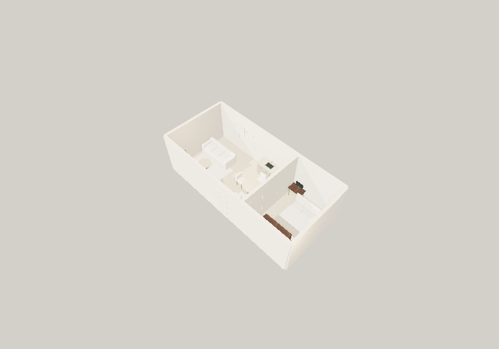

# 3D IDbuild home

Turn a PNG, JPEG, or PDF floor plan into an editable 3D model. The local studio supports scale review, floor plan and WebGL views, movable furniture, lighting, undo and redo, and portable projects. Try the fictional **Juniper Apartment** demo before configuring AI.



## Install and run

Use Node.js 24 LTS, pinned to 24.18.0 in `.nvmrc`, with its bundled npm. Use a current browser with WebGL 2 enabled. Install dependencies from the repository root. With nvm, run `nvm install` and `nvm use` first. On Windows you can install Node 24 from nodejs.org and run commands in PowerShell.

```sh
npm ci
npm run dev
```

Open the loopback address Vite prints. For production mode, run `npm run build` then `npm start` and open http://127.0.0.1:4173. Copy `.env.example` to `.env` to set a different production port. Vite uses `npm run dev -- --port 5175` for a different development port. Each port has its own browser project library.

npm installs Three.js, React, Vite, PDF.js, the geometry libraries, and TypeScript tools. Rendering uses Three.js and WebGL 2. No separate engine, database, Blender installation, or local AI model is needed. Blender is optional for processing exported GLB files.

## Bring your own OpenAI key

1. Start the local app and select **OpenAI key**. Paste your own OpenAI API key directly into the panel. Choose an image-capable model that supports structured outputs. The default is `gpt-4.1-mini`. [OpenAI model documentation](https://developers.openai.com/api/docs/models/gpt-4.1-mini)
2. Select **Validate**. The local server checks whether the key can access the selected model using the OpenAI Models API. This check does not exercise image analysis or confirm available billing credit.
3. Upload a plan and select **Analyse plan**. A successful trace and review screen verify the image request. OpenAI charges the API account associated with your key. Change the key or select **Remove** from the same panel.

The key stays in browser memory and travels in the authorization header to the local Node service, which forwards it to OpenAI. Browser developer tools and extensions with sufficient permissions can inspect it. The app does not persist the key in browser storage or exported projects. Keep it out of `.env`, `VITE_*` variables, source code, and chat messages. The app sends the analysis image and conversation to OpenAI only when analysis is requested. The shipped service binds to loopback and is designed for one local user.

## Review and edit

Upload a PNG, JPEG, or PDF up to 20 MB. A [fictional floor plan](docs/juniper-plan.png) is available for testing. Pick a PDF page if needed. PDFs are limited to 50 pages and images to 25 megapixels. Confirm a known span in centimetres and the ceiling height. Inspect the overlay and correct provisional wall and opening positions before opening the editable scene. The model represents a single floor and remains provisional where source measurements are incomplete.

Use **Architecture mode** to edit walls, add furniture from the catalogue, and move between **Floor plan** and **3D interior**. Browser projects autosave in IndexedDB. Save an editable `.fdwz3d` archive before transferring browsers or clearing site data. A portable archive includes its source, edits, and resources. GLB and PNG downloads are presentation formats. Import accepts SH3D and v1–v3 project archives. Use `/verify.html` for a separate check of a self-contained GLB.

## Develop and troubleshoot

```sh
npm test
npm run lint
npm run build
```

- If install fails, check `node --version` against `.nvmrc` and rerun `npm ci`.
- If a port is occupied, choose another port using the settings above.
- If 3D is blank, enable hardware acceleration and WebGL 2, update your browser or graphics driver, and try the demo.
- If OpenAI reports a rejected key, model denial, billing issue, or rate limit, check the key, model permissions and billing in your API account. Live calls require internet access.
- If a model references remote textures, re-export it as a self-contained GLB. Import limits and local project recovery are described in the editing workflow above.

React and TypeScript power the editor. PNG/JPEG and PDF.js decoding, geometry preparation and project persistence run in the browser. The local Node adapter forwards OpenAI requests, validates responses and returns bounded trace data. See [AGENTS.md](AGENTS.md), [CONTRIBUTING.md](CONTRIBUTING.md), [SECURITY.md](SECURITY.md), and [third-party notices](THIRD_PARTY_NOTICES.md). Original application code and the fictional demo are under the [MIT licence](LICENSE).
